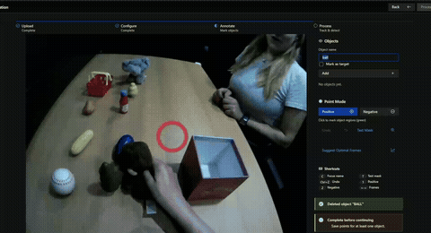

<h1 align="center">EnvisionObjectAnnotator (Experimental MobileSAM+Cutie Fork)</h1>

This is a fork of <a href="https://github.com/levankhaduri/EnvisionObjectAnnotator">levankhaduri/EnvisionObjectAnnotator</a>; see that repository for full documentation, setup instructions, etc. Also note this is just an experimental fork, so there may still be bugs or unexpected behavior.

See the quantitative analysis PDF [here](Envision_report__mobilesam_cutie_.pdf).

## Changes made

- Replaced SAM2 backend with MobileSAM+Cutie (also stripped out a lot of the code of SAM2)
- Removed the "add target marker" modal pop-up
- List of all currently added objects
- Auto-save
- Updated setup.sh to install MobileSAM's and Cutie's requirements

## Demos

  <b>Real-time click-to-mask with MobileSAM</b> 
  </img>

  <b>Result of Cutie propagation</b> 
  </img>

Note that the target marker is not annotated in the video, which likely would have made it harder (hence the idea of being able to supply the raw .csv gaze data rather than tracking the gaze circle).

## Setup

Setup (and running the program) is still the same, follow the original instructions from: [levankhaduri/EnvisionObjectAnnotator](https://github.com/levankhaduri/EnvisionObjectAnnotator)
